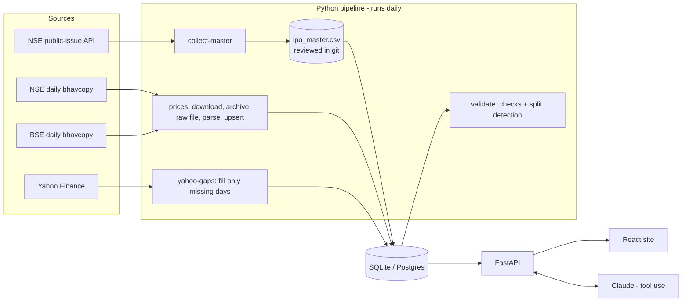

# IPO Tracker

**How did every Indian IPO actually do for the people who applied?**

Pick any 2026 mainboard or SME IPO and see the minimum application for each investor category (retail, small HNI, big HNI, employee and shareholder quotas), and what that application was worth on listing day, today, and on any date you choose. Prices are adjusted for splits and bonuses so they always compare fairly with the issue price. An "Ask AI" page answers questions in plain English using the same data.

Built with **FastAPI · SQLAlchemy · React + TypeScript · a Python data pipeline **.

---

## What it does

- **IPO list**: every IPO with issue price, lot size, minimum investment, listing-day return and return today. Filter by mainboard or SME, search, and sort.
- **IPO page**: the minimum application in every category it offered, its cost, and the profit or loss on listing day, today and a date you pick (date picker, quick picks like "+1 month", or click the chart).
- **Correct after splits and bonuses**: a 1:10 split doesn't show up as a 90% crash.
- **Ask AI**: "If I got one retail lot in every SME IPO this year, how much would I have made?" Claude answers by calling four typed lookups against the database, and the page shows exactly which lookups it ran.

## Architecture



| Part | Where | What it does |
|---|---|---|
| Category rules | `backend/app/services/categories.py` | Minimum and maximum application per category, for mainboard and the new SME rules. Pure functions, fully tested. |
| P&L | `backend/app/services/pnl.py`, `prices.py` | Price on or before a date, split/bonus adjustment, P&L per category. |
| API | `backend/app/api/` | `/api/ipos`, `/api/ipos/{isin}`, `/api/ipos/{isin}/pnl?date=`, `/api/ipos/{isin}/prices`, `/api/meta`, `/api/ask`. Interactive docs at `/docs`. |
| Pipeline | `backend/pipeline/` | Exchange downloads with retries, raw-file archive, idempotent loads, Yahoo fallback, validation. |
| AI | `backend/app/ai/` | Tool definitions, the tool-use loop, and a daily usage limit. |
| Site | `frontend/src/` | List page, IPO page, chart, Ask page. |

## Data sources and why

| Source | Used for | Why |
|---|---|---|
| NSE public-issue API | Issue price, lot size, dates, quotas, employee discount, subscription | Official, and the same data NSE's own IPO pages show. |
| NSE and BSE bhavcopy (UDiFF format) | Daily closing prices | Official end-of-day files, free, cover mainboard and SME, published openly. |
| Yahoo Finance (`yfinance`) | Backup for days both exchange files missed | Free and easy; unofficial, so it only ever fills gaps and never overwrites exchange data. |

A broker API (for example Dhan) was considered and left out of version one: it costs a monthly fee, its access token expires every 24 hours (a daily manual step for an unattended job), it is rate-limited, and broker data is licensed to the account holder, so showing it to the public may not be allowed. It could be added later as one more source behind the same interface.

## Engineering decisions worth knowing

1. **Store prices as traded, adjust when reading.** Exchange files are not adjusted for splits or bonuses. The database keeps the real traded price, and `corporate_actions.csv` says how many shares one allotted share became (10 after a 1:10 split, 2 after a 1:1 bonus). Adjusting at read time means a newly discovered split fixes every page instantly, with no data rewrite.
2. **Yahoo prices are converted back to as-traded.** Yahoo rewrites old prices after a split. Mixing those with exchange prices would create fake jumps, so `pipeline/sources/yahoo.py` undoes Yahoo's adjustment before saving.
3. **Unexplained jumps fail validation.** Daily price limits cap moves at 20%, so a bigger overnight move means a corporate action. `pipeline/actions.py` finds these and suggests the ratio; it caught both real cases in the 2026 data (Waterways Leisure Tourism's 1:10 split and Aastha Spintex's 1:1 bonus).
4. **Idempotent, resumable loads.** Prices are upserted on (ISIN, date, exchange) and every download attempt is logged in `ingestion_runs`. Re-running a day changes nothing; failed days are retried on the next run; `--force` reloads on purpose.
5. **Raw files are archived before parsing.** Every bhavcopy is saved under `data/raw/`, so a parsing bug can be fixed and the day replayed without downloading again.
6. **Built for NSE's bot protection.** NSE checks headers and cookies, rate-limits and often blocks cloud servers. The pipeline warms up a session, retries with exponential backoff (403/429/5xx/timeouts), treats 404 as a holiday, and doesn't depend on NSE alone: BSE and Yahoo cover for it, and the website only ever reads the database.
7. **IPO details as reviewed data.** The master list is a CSV in git, so every change shows as a diff in a pull request. The collector only updates rows it owns (`source=nse_api`); hand-corrected rows (`source=manual`) are never overwritten.
8. **The AI can't write SQL.** Claude chooses from four typed tools whose inputs are validated. That blocks prompt injection from reaching the database, keeps answers grounded in real numbers, and makes each answer auditable (the tool calls are returned with the answer). A daily limit per visitor and overall keeps a public demo's cost bounded.

## Investor categories (how minimums are worked out)

| Category | Mainboard | SME (issues opening on or after 1 July 2025) |
|---|---|---|
| Retail / individual | Up to ₹2 lakh, minimum 1 lot | Exactly 2 lots, and 2 lots must cost more than ₹2 lakh |
| Small HNI (sNII) | Over ₹2 lakh up to ₹10 lakh: smallest lots costing more than ₹2 lakh | More than 2 lots up to ₹10 lakh: from 3 lots |
| Big HNI (bNII) | Over ₹10 lakh: smallest lots costing more than ₹10 lakh | Same |
| Employee quota | Up to ₹5 lakh, minimum 1 lot, often at a discount | Minimum 2 lots |
| Shareholder quota | Up to ₹2 lakh, minimum 1 lot | Minimum 2 lots |

When a category is oversubscribed, winners are picked by lottery and each gets the minimum application, which is why P&L is shown for the minimum. An IPO's offer document can override these (`individual_min_lots`, `snii_min_lots`, `bnii_min_lots` in the master CSV). The SME rules follow NSE circular IPO68604.

## Run it on your Computer

You need Python 3.10+ and Node 18+. macOS's built-in Python is 3.9, so install a newer one first (`brew install python@3.12 node`) and run `make setup PYTHON=python3.12`.

```bash
make setup                 # venv + Python and Node dependencies
make load                  # put the IPO list (backend/data/ipo_master.csv) into the database
make backfill              # download daily prices since 1 Jan 2026 (about 210 trading days, NSE + BSE)
make validate              # data checks
make api                   # API on http://localhost:8000  (try http://localhost:8000/docs)
make web                   # site on http://localhost:5173  (in a second terminal)
```

The backfill downloads about 420 exchange files the first time (a few minutes) and keeps them in `backend/data/raw/`, so later runs are quick. To turn on the Ask AI page, copy `backend/.env.example` to `backend/.env` and set `ANTHROPIC_API_KEY`.

To refresh the IPO list from NSE (new listings): `make master`, review the diff in `backend/data/ipo_master.csv`, then `make load`.

## Deploying (free tiers)

- **Database**: Postgres on Neon or Supabase. Set `DATABASE_URL=postgresql+psycopg://...`.
- **API**: Render or Railway using `backend/Dockerfile`. Set `DATABASE_URL`, `CORS_ORIGINS` (your site's URL) and optionally `ANTHROPIC_API_KEY`.
- **Site**: Vercel or Netlify from `frontend/`, build command `npm run build`, output `dist`, and `VITE_API_URL` set to the API's URL.
- **Daily prices**: `.github/workflows/daily-prices.yml` runs on weekdays at 7:30 pm IST with the `DATABASE_URL` secret. If NSE blocks GitHub's servers, the BSE file and Yahoo still fill the day; running `make daily` from your own machine on a schedule (cron or launchd) is the fallback.

## Tests

```bash
make test
```

Backend tests use **real exchange rows** saved in `backend/tests/fixtures/` (including the actual split and bonus days), saved NSE API responses for the collector, fake HTTP clients for retry behaviour, and a fake Claude client for the tool-use loop. CI (`.github/workflows/ci.yml`) runs lint, tests, type checks and a production build on every push.

## Known limits and next steps

- **BSE-only SME IPOs** (the BSE SME platform) aren't collected yet; the NSE collector covers mainboard IPOs and NSE Emerge SME IPOs. Next: a BSE collector feeding the same CSV. BSE-only mainboard listings can be added by hand (two are, with `source=manual`).
- Subscription figures in the starter CSV are blank until `make master` is run, which fills the consolidated (all-exchange) figures.
- Returns ignore dividends, brokerage and tax.
- The AI usage limit is kept in memory, which suits a single server; with several servers it should move to Redis.

## Disclaimer

This shows past performance only and is not investment advice.
